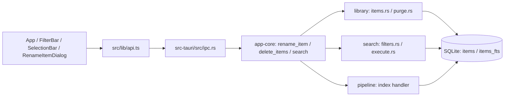

## 产品概述
在现有素材库工作区中补齐三类日常整理能力：按条件快速筛选素材、给素材重命名、一次清理多条素材。沿用现有单窗口布局（左标签栏 / 中结果区 / 右详情），不新增页面。

## 核心功能
### 搜索筛选
- 搜索框右侧新增筛选条：类型（图片/文字/链接）、时间范围（今天/近 7 天/近 30 天/今年/自定义起止日期）、标签、状态（解析中/正常/待解析/失败）。
- 各维度支持多选：同一维度内「任一命中」，不同维度之间取交集；与关键词条件同时生效。
- 结果区上方展示当前生效条件的可移除 chip，点 × 立即取消该条件并刷新；提供「清空全部筛选」。
- 侧栏标签点击改为切换标签筛选（可多选、高亮已选），不再改写搜索框文字。
- 无关键词时列表仍按时间倒序分页加载；有关键词时走既有语义/字面/条件检索。

### 素材标题重命名
- 新增用户可编辑标题：未改名时显示来源标题，改名后卡片与详情都显示新标题；来源标题仍保留在详情信息中。
- 卡片悬停出现「重命名」入口，详情标题旁有铅笔按钮；弹窗预填当前标题，Enter 保存、Esc 取消，上限 200 字。
- 标题清空即恢复显示来源标题；新标题参与全文检索。

### 批量删除
- 显式入口：结果区标题行（`result-bar`）右侧常驻「选择」按钮，点击进入多选模式；按钮同时变为「完成」，再点一次退出并清空选择。
- 多选模式下：所有卡片左上角常驻复选框，卡片点击改为切换选中（不再打开详情），卡片上的复制/重命名悬停按钮隐藏；`Shift+点击` 连选区间，`Ctrl+A` 全选已加载项，`Esc` 退出多选模式。
- 非多选模式：保持现状（点卡片开详情），不显示复选框，避免误触与视觉噪声。
- 列表与检索结果共用同一套多选交互；进入多选模式后顶部滑出操作条：「已选 N 项 / 全选当前筛选下 N 项 / 取消选择 / 删除」。
- 删除前二次确认，写明将删除 N 项素材及其原图、缩略图且不可恢复，默认焦点在取消。
- 删除完成提示成功与失败数量；已删除素材的详情自动收起，选择集清空；多选模式保留，便于继续清理。
- 详情面板原有单条删除保留。

## 视觉与交互
沿用暖白纸感 + 水墨点缀的界面语言：筛选为轻量 pill 按钮 + 浮层面板，选中态用赭石色描边与勾选；操作条为贴顶细条，不遮挡网格；浮层淡入并有轻微位移，键盘可完整操作；明暗主题下层级均清晰。


## 技术栈
- 前端：React 19 + TypeScript + TanStack Query v5，沿用现有自定义 CSS 令牌体系（tokens.css），不引入 UI 组件库
- 后端：Tauri 2 命令层 `src-tauri/src/ipc.rs` + Rust workspace（domain / library / search / pipeline / app-core）
- 存储：SQLite + FTS5（`items_fts`），迁移按 `crates/library/src/migrations.rs` 的 `MIGRATIONS` 追加
- 类型桥：tauri-specta 生成 `src/lib/bindings.ts`，禁止手改

## 实现方案

### 1. 数据层：标题字段与筛选查询
- 新增 `crates/library/migrations/0007_item_title.sql`：`ALTER TABLE items ADD COLUMN title TEXT;`，可空、不回填（个人库规模下避免迁移期全表写）。
- `Item` 增加 `title: Option<String>`；`NewItem` 不加字段（插入恒为 NULL），减少所有捕获/导入调用点与测试构造的改动。
- `crates/library/src/items.rs`：
  - `COLUMNS` 末尾追加 `i.title`，`row_to_item_offset` 补读；`insert_item_with_id` 写入 NULL。
  - `set_item_title(id, Option<&str>)` 复用 `set_note` 的模式：trim、按字符校验（`MAX_TITLE_CHARS = 200`）、空串转 NULL、刷新 `updated_at`，提交后调用 `notify_metadata_changed(&[id])`；既有钩子会 `bump_revision_and_enqueue(index)`，FTS 标题自动重建。
  - `list_items_filtered(filters, cursor, limit)`：键集分页（`captured_at DESC, rowid DESC`），条件全部下推为 SQL；类型/状态用 `IN`，标签用 `EXISTS + IN`（标签组内 OR），时间用左闭右开区间。
  - `list_item_ids_filtered(filters)`：只 `SELECT i.id`，默认上限 2000，供「全选当前筛选」。
- `crates/domain/src/search.rs` 新增 `ItemFilters { kinds, statuses, tags, time_from, time_to }` 与 `is_empty()`；组内 OR、组间 AND 的语义写进文档注释。

### 2. 检索链路：关键词与结构化条件同源
- `crates/search/src/filters.rs` 新增 `to_sql_with_filters(&ParsedQuery, &ItemFilters)`、`passes_with_filters(...)`、`matched_labels(...)` 的筛选标签；保留原 `to_sql` / `passes` 作为默认空过滤的委托，避免破坏既有测试。
- `SearchRequest` 增加 `filters: ItemFilters`；`execute::search` 用合并后的候选集（FTS 与向量通道共用同一候选集，避免融合后再过滤造成「解释说命中、实际被筛掉」）。
- `app-core::search` 透传 filters；IPC 的 `search_items` 增加可选 `filters` 参数。
- 无关键词时不走检索链路：`list_items_filtered` 直接 SQL 分页，更快且可续页。

### 3. 标题与批量删除的命令与事件
- `app-core::rename_item(id, title)`：调用 `library.set_item_title`，发 `ItemRenamed { id }`；IPC `item_rename` 返回更新后的 `ItemDto`（含 preview）。
- `app-core::delete_items(ids)`：逐条复用现有 `delete_item` 的编排（外部引用排除清理 + `library.delete_item`，文件与 FTS 清理在库层），`NotFound` 计入已删除（幂等），其他错误计数；结束后只发一次 `ItemsDeleted { deleted, failed }`，不逐条发 `item_deleted`，避免 N 次 `resetQueries`。
- 单批上限 500；前端在超过时循环分批调用并显示进度，保证返回及时、失败可汇总。
- `crates/app-core/src/events.rs` 增加 `ItemRenamed(ItemEvent)`、`ItemsDeleted(ItemsDeletedEvent)` 的 `name()` 与 `payload()`，并补名称/载荷稳定性测试。
- `src-tauri/src/ipc.rs`：`ItemDto` 增 `title`；新增 `ItemFiltersDto`、`BatchDeleteReportDto`；注册 `item_rename`、`item_delete_many`、`list_items_filtered`、`list_item_ids_filtered`。
- `src/lib/events.ts`：`item_renamed` → 失效 detail / items / search（用 invalidate 保留分页与滚动位置，重命名不改变排序）；`items_deleted` → reset items，并失效 usage / orphans / purgePreview / tags。

### 4. 前端状态与界面
- `src/lib/filters.ts`：前端筛选类型、时间预设（今天/近 7 天/近 30 天/今年/自定义）、条件 chip 文案、稳定序列化 key。
- `useItemFilters` + `FilterBar`（四个 pill 与浮层面板）+ `ActiveFilterChips`；数据源选择：关键词空且无筛选 → `useItems()`；无关键词有筛选 → `useFilteredItems(filters)`；有关键词 → `useSearch(query, filters)`。
- `useSearch` 接受 filters，并把序列化后的筛选 key 纳入依赖与序号重置，保持既有 250ms 防抖与过期丢弃语义。
- `useSelection(orderedIds)`：选择模式开关、选择集、anchor、Shift 区间连选、全选/清空、列表变化后裁剪；进入模式时清空选择与 anchor，退出模式时清空选择并收起操作条。
- `App` 在 `result-bar` 右侧渲染「选择 / 完成」切换按钮；`Ctrl+A` 仅在多选模式下全选已加载项，`Esc` 优先退出多选模式（其次才收详情），输入框内不生效。
- `SelectionBar` + 复用 `ConfirmDialog`；`RenameItemDialog`（预填、200 字计数、Enter/Esc、空值提示「将显示来源标题」）。
- 卡片与详情标题统一走 `title ?? sourceTitle ?? "未命名素材"`；`ItemCard` 新增 `selectionMode`、`selected`、`onToggleSelect`：多选模式下复选框常驻、点击卡片切换选中、隐藏复制/重命名按钮；非多选模式保持原有打开详情与悬停重命名。
- 侧栏标签改为切换 `filters.tags`（多选），`activeTag` 改为 `activeTags`。

## 性能与一致性
- 列表筛选单次查询 O(limit)，键集分页复用 `idx_items_captured`；标签 EXISTS 走既有 `idx_item_tags_tag`；个人库规模不额外建索引，万级后再补 kind 索引。
- 「全选当前筛选」只查 id 并限 2000，避免把大数组塞进 UI 状态与事件载荷。
- 批量删除每条独立事务，单条失败不回滚整批；事件单发，避免事件风暴与重复列表重置。
- 标题改动复用元数据钩子触发 revision + index，不新增管线分支。

## 实现注意
- `Item` 增字段会命中所有测试字面量（`crates/library/tests`、`crates/search/tests`、`crates/pipeline/tests` 与模块内测试），统一补 `title: None`；不要给 `Item` 加 `Default`，避免漏填被掩盖。
- `bindings.ts` 只能通过 `cargo test refresh_committed_bindings -- --ignored` 刷新，并保持 `committed_bindings_are_up_to_date` 通过。
- 迁移不回填标题；所有读路径回落到 `source_title`，旧库语义不变；清空标题写 NULL 而不是空串。
- 不改 `useSearch` 的过期响应丢弃机制：筛选变化也必须让在途响应失效。
- 筛选 chip 与 `parsed.chips` 分两行渲染：结构条件由前端状态驱动删除，关键词条件继续走 `stripChip`，避免两套语义互相污染。
- 选择模式与详情打开互斥：进入多选模式时收起详情列（或保持不变但卡片点击不再开详情），退出后恢复原行为；`Esc` 先退出选择模式。
- 删除后立即清理选择集与 `selectedId`（不必等事件），事件到达后再以服务端状态为准。
- 后端日志用 `tracing`，前端提示用 `pushToast`；不记录素材正文与绝对路径。

## 架构设计


## 目录结构
```
VisRecall/
├── crates/
│   ├── domain/src/
│   │   ├── item.rs                       [MODIFY] Item 增 title: Option<String>；NewItem 不变
│   │   └── search.rs                     [MODIFY] 新增 ItemFilters 与 is_empty；组内 OR、组间 AND
│   ├── library/
│   │   ├── migrations/0007_item_title.sql [NEW] ALTER TABLE items ADD COLUMN title TEXT
│   │   ├── src/migrations.rs             [MODIFY] MIGRATIONS 追加 (7, include_str!(...))
│   │   ├── src/items.rs                  [MODIFY] COLUMNS/row 映射加 title；set_item_title；list_items_filtered；list_item_ids_filtered
│   │   └── tests/items_filter_db.rs      [NEW] 标题写回/回落、各筛选维度、分页、标签 OR
│   ├── search/src/
│   │   ├── filters.rs                    [MODIFY] to_sql_with_filters / passes_with_filters / 结构化命中文案
│   │   ├── execute.rs                    [MODIFY] SearchRequest.filters 与合并候选集
│   │   └── lib.rs                        [MODIFY] 导出新函数
│   ├── pipeline/src/
│   │   ├── handlers/index.rs             [MODIFY] FTS title 取 item.title.or(source_title)
│   │   └── lifecycle.rs                  [MODIFY] 同上，保证写入侧与查询侧一致
│   └── app-core/src/
│       ├── app.rs                        [MODIFY] rename_item / delete_items / search 透传 filters
│       └── events.rs                     [MODIFY] ItemRenamed、ItemsDeleted 变体、name/payload 与测试
├── src-tauri/src/ipc.rs                  [MODIFY] ItemDto.title、ItemFiltersDto、BatchDeleteReportDto、四个新命令、search_items 增 filters、collect_commands
├── src/
│   ├── lib/
│   │   ├── bindings.ts                   [GENERATED] 由 refresh_committed_bindings 刷新
│   │   ├── api.ts                        [MODIFY] renameItem / deleteItems / listItemsFiltered / listItemIdsFiltered；search 增 filters
│   │   ├── events.ts                     [MODIFY] item_renamed（invalidate）与 items_deleted（reset + 失效用量/标签/孤儿）
│   │   ├── queryClient.ts                [MODIFY] itemsFiltered(filtersKey) 查询键
│   │   └── filters.ts                    [NEW] 筛选类型、时间预设、chip 文案、稳定 key
│   ├── features/
│   │   ├── search/
│   │   │   ├── FilterBar.tsx             [NEW] 四个 pill、浮层面板、复选与时间自定义
│   │   │   ├── ActiveFilterChips.tsx     [NEW] 生效条件 chip、单条移除、清空全部
│   │   │   ├── useItemFilters.ts         [NEW] 筛选状态、切换/清空、chip 派生
│   │   │   ├── useSearch.ts              [MODIFY] 接受 filters 并重置在途序号
│   │   │   └── ResultGrid.tsx            [MODIFY] 透传选择模式、选择态与切换回调
│   │   ├── library/
│   │   │   ├── useItems.ts               [MODIFY] 新增 useFilteredItems 无限分页
│   │   │   ├── useSelection.ts           [NEW] 选择模式开关、选择集、anchor、Shift 区间、全选/清空/裁剪
│   │   │   ├── SelectionBar.tsx          [NEW] 已选数量、全选当前筛选、取消、删除
│   │   │   ├── RenameItemDialog.tsx      [NEW] 预填、200 字计数、Enter/Esc、空值提示
│   │   │   ├── ItemCard.tsx              [MODIFY] 标题回退、选择模式复选框、重命名入口
│   │   │   └── ItemGrid.tsx              [MODIFY] 有序 id 与选择态接线
│   │   ├── detail/DetailPanel.tsx        [MODIFY] 标题回退与铅笔入口（复用重命名弹窗）
│   │   └── shell/Sidebar.tsx             [MODIFY] activeTags 多选与切换，不再改写查询串
│   ├── app/App.tsx                       [MODIFY] 数据源切换、筛选、选择模式与「选择/完成」按钮、批量删除接线、Ctrl+A 与 Esc
│   └── styles/
│       ├── search.css                    [MODIFY] filter pill、浮层、条件 chip
│       ├── library.css                   [MODIFY] 卡片复选框与选中描边、操作条
│       └── dialogs.css                   [MODIFY] 重命名弹窗
└── 前端测试（随源码同目录）
    ├── src/features/search/FilterBar.test.tsx         [NEW] 选择条件、清空、无障碍属性
    ├── src/features/library/useSelection.test.tsx     [NEW] 模式开关、Shift 区间、全选、裁剪
    ├── src/features/library/RenameItemDialog.test.tsx [NEW] 空值清空、Enter/Esc、字数上限
    ├── src/features/library/ItemCard.test.tsx         [MODIFY] 标题回退、选择模式下点击切换选中
    ├── src/features/library/ItemGrid.test.tsx         [MODIFY] 选择接线
    ├── src/features/shell/Sidebar.test.tsx            [MODIFY] 标签多选
    └── src/app/App.test.tsx                           [MODIFY] 「选择/完成」切换、筛选数据源、批量删除确认流程
```

## 关键数据结构
前端筛选与批量删除结果契约（IPC 与 api.ts 共用）：
```ts
type ItemFilters = {
  kinds: string[];
  statuses: string[];
  tags: string[];
  timeFrom: number | null;
  timeTo: number | null;
};

type BatchDeleteReport = { deleted: number; failed: number };
```

选择模式前端状态（`useSelection` 返回）：
```ts
type SelectionState = {
  selectionMode: boolean;       // 「选择/完成」按钮控制的模式开关
  selectedIds: Set<string>;
  enter(): void;                // 进入模式：清空选择与 anchor
  exit(): void;                 // 退出模式：清空选择、收起操作条
  toggle(id: string, shift: boolean): void;
  selectAllLoaded(): void;
  clear(): void;
};
```


## 设计风格
延续现有「暖白纸感 + 水墨点缀」的桌面素材库语言：细线分隔、低饱和赭石与朱砂点缀、无阴影堆叠。新增控件只使用既有令牌（--bg / --frame / --surface / --line / --seal / --hue-ochre），不引入新色板；过渡统一 160–240ms 的 `--ease`，浮层淡入并上移 4px，动效克制。

## 区块设计
1. **检索与筛选区**（main-head）：搜索框保持原宽，右侧接一排 pill 按钮「类型 / 时间 / 标签 / 状态」；有选中值时显示数量角标（如「类型 2」）并转为深色实心。点击在按钮下方 8px 展开 260–300px 浮层，内含复选行与「全选 / 清空」，点外部或 Esc 关闭。
2. **生效条件 chip 行**：搜索框下方一行，chip 浅底细边圆角，左侧条件名、右侧 ×，行首「筛选」标签区分关键词 chip，行尾「清空全部」文字按钮；条件多时横向滚动不换行。
3. **result-bar 右侧「选择」按钮**：细线描边小按钮，位于结果计数同行右侧；点击进入多选模式后文字变「完成」并转为实心强调态，再次点击退出。多选模式下筛选栏保持可用（筛选变化后选择集按存在的 id 裁剪）。
4. **结果网格与选择态**：网格与卡片尺寸不变；**仅多选模式**下卡片左上角显示 18px 圆角复选框（选中后显示勾），非多选模式不显示。多选模式下卡片点击=切换选中、不打开详情，隐藏复制/重命名悬停按钮；选中卡片加 1.5px 赭石色描边与轻微内阴影，不改变布局，且不触发卡片抬升。
5. **批量操作条**：多选模式下位于 result-bar 下方、粘顶细条（高 44px，surface 底 + 下边线）；左侧「已选 N 项」，右侧「全选（N）」「取消选择」「删除」；删除为朱砂 danger 态。退出多选模式或未选中时整条淡出并移出文档流，不占据网格空间。
6. **重命名弹窗**：居中 400px 面板，标题「重命名素材」，输入框预填当前标题，右下角 0/200 计数；底部「取消 / 保存」，Enter 保存、Esc 取消、失焦不自动提交；输入为空时提示「将显示来源标题」。
7. **详情标题编辑**：标题右侧铅笔小按钮，hover 显现；点击打开同一弹窗，保存后标题就地更新，来源行（应用 / 时间 / 状态）保持不变。

## 响应式与可达性
桌面优先：≥1100px 筛选 pill 显示文字，更窄时只显示图标与角标；操作条与 chip 行可横向滚动。所有控件有 2px 赭石色 focus ring；复选框有 aria-checked 与可读标签，操作条用 role=status 播报已选数量，「选择/完成」按钮用 aria-pressed 表示模式状态，浮层打开时焦点进入面板并在关闭后回到触发按钮。暗色主题下描边与浮层依赖 --line-2 与 --elevated，保持层级可辨。

### Skill
- **frontend-design**
  - Purpose: 打磨筛选栏、生效条件 chip、批量操作条与重命名弹窗的视觉层级、选中态与微交互，确保与既有纸感设计语言一致
  - Expected outcome: 产出可直接落地的样式与交互细节（hover / focus / 暗色主题 / 横向滚动），不引入新色板或组件库依赖
