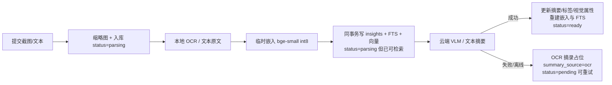
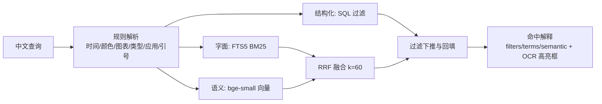

# 目记 VisRecall · 阶段三（AI 与检索）架构设计

> 文档版本：v1.0（定稿）
> 状态：已定稿（2026-11-08 评审通过，§0 决策表逐项确认，无修改意见）
> 日期：2026-11-07（v0.2 修订：2026-11-08；v1.0 定稿：2026-11-08）
> v0.2 修订：**图搜图确认不做（含二期）**——移除 CLIP 图向量通道的预留与「二期补建」表述，外观相似检索改写为产品范围声明
> 依据：《VisRecall-技术架构设计 v1.2》、《specs/v0.1/README.md》（阶段 03 范围定义）、《多模态素材检索系统调研与方案设计》（2026-11，调研对象：DeepImageSearch / NekoImageGallery / VectorGallery / MaterialSearch / similarities）
> 范围：回答阶段 03「AI 与检索」的存储、索引、检索架构选型与理由。主架构文档已定的内容（捕获、进程模型、Provider 抽象）只引用不重复；本文档**不推翻** v1.2 的任何决策，只做细化与选型论证。
> 后续动作：已完成——2026-11-08 按 §10 拆分为 `docs/specs/v0.1/03-ai-search/` 四件套（requirements / design / tasks / verification）。本文档转为决策依据存档；落地细化（含与本文的澄清/偏差清单）见 `03-ai-search/design.md` §1，后续变更先改 spec。

---

## 0. TL;DR

| # | 决策 | 结论 | 一句话理由 |
|---|---|---|---|
| A1 | 存储底座 | **SQLite 全家桶（FTS5 + 向量表），不引入 Qdrant/PG/LanceDB** | FTS+向量+元数据同事务、单文件可搬移、零进程零端口，是桌面单用户的最优解 |
| A2 | 向量检索方式 | **主路径：普通表 int8 BLOB 暴力余弦；`sqlite-vec` vec0 仅作可选快路径** | 测试规模 ≤20 条、真实量级数千~数万，暴力毫秒级；不押注早期项目 sqlite-vec |
| B1 | 全文通道 | **jieba 预分词 + FTS5 BM25（unicode61）**；P1 加 trigram 表做引号短语 | 中文召回可控可测；不做自定义 SQLite 分词器（破坏打包简单性） |
| B2 | 嵌入模型 | **bge-small-zh-v1.5（512 维 int8，ort CPU）**；base-zh 作评测驱动的升级备选 | 嵌入在查询路径上，必须本地、必须小；bge-m3 体积超内存预算一个量级 |
| B3 | OCR | PP-OCRv5/v4 mobile ONNX 主路径 + Windows.Media.Ocr 兜底（沿 v1.2，本阶段落地） | 中文截图最稳、带置信度、离线；Windows OCR 零依赖兜底 |
| C1 | 索引管线 | **两阶段：OCR→临时嵌入→可检索（≤3s P95）；VLM 完成后增强重建** | 参考项目全部是"索引完才可搜"；新鲜度是我们的差异化硬指标 |
| C2 | 任务队列 | **已有 jobs 表（迁移 0001）+ 2 worker + 指数退避**，不引入外部队列 | 同库事务、崩溃可恢复、`(item_id, stage, revision)` 幂等 |
| C3 | 索引生命周期 | revision 幂等 + `model_id` 固定于库 + 向量表蓝绿重建 | 参考项目的集体盲区（调研结论 4），我们必须做对 |
| D1 | 查询解析 | 纯本地规则解析（时间/颜色/图表/类型/应用/引号），chip 回显 | 查询路径零网络、零大模型，延迟与可解释性可控 |
| D2 | 召回通道 | **三路：结构化过滤（SQL）+ FTS BM25 + 语义向量**；本阶段无 CLIP | 图片经"OCR 全文 + VLM 摘要"文本化后检索；外观相似检索不在产品范围（不做图搜图，含二期） |
| D3 | 融合 | **应用层 RRF（k=60），权重配置化，评测集校准** | 服务端融合（Qdrant Query API）在 SQLite 世界不存在；RRF 免归一化、可回放 |
| D4 | 命中解释 | Explanation 结构（filters/terms/semantic）+ OCR 高亮框映射 | 调研指出五个参考项目均无命中原因标注——这是我们的产品差异化 |
| E1 | 质量评测 | 50 条真实查询评测集，Top-3 命中率 ≥80% 为阶段退出门禁；分桶统计 | 回应调研批评点 5「融合权重全靠拍脑袋」，调参靠数据 |

---

## 1. 范围与硬约束

### 1.1 阶段 03 的功能范围（来自 specs/v0.1/README.md §2）

| 功能 | 内容 |
|---|---|
| F2.1–F2.4 理解与索引 | OCR、VLM 摘要/标签/视觉属性、本地嵌入、两阶段索引 |
| F3.1–F3.4 检索 | 查询解析、chip、命中解释、筛选、FTS+向量+RRF |
| F7.1 模型配置 | 密钥（凭据管理器）、连通性/视觉能力探测、主备切换 |

### 1.2 硬约束（不可协商，选型全部以此为前提）

| 约束 | 值 | 来源 |
|---|---|---|
| 素材测试规模 | **≤20 条**（2026-11-06 起；20 条结论不得外推为大规模性能结论） | specs README §3 |
| 入库→可检索 | ≤3s（P95） | PRD NFR |
| 检索延迟 | ≤800ms（P95，测试规模内） | PRD NFR |
| 托盘常驻内存 | 40–70MB 目标，150MB 硬上限；嵌入模型 int8 约 30–60MB | v1.2 §4.9 |
| 主窗口内存 | 160–280MB（含嵌入模型） | v1.2 §4.9 |
| 离线 | 查询路径（解析/FTS/嵌入/向量）**零网络**；云端 VLM 仅入库侧，且需对应设置开关开启 | v1.2 §6.7 |
| 进程模型 | 单进程 `visrecall.exe`，无服务、无端口 | v1.2 §3.1 |
| 数据形态 | 单文件 SQLite，明文、用户可见、可整体搬移 | v1.2 §5.1 |
| 明确不做 | CLIP 图向量通道、视频、本地 VLM、云端重排、搜索历史（F3.7）、相似推荐（P2）；**图搜图不做（含二期）** | v1.2 §11.2 + 2026-11-08 决策 |

> 规模的现实判断：≤20 条是**验收口径**，不是产品终局。个人真实使用会在一年内积累数千条。本文档所有选型按"验收规模 20 条、设计上限约 10 万条、超出再引入 ANN"的梯度论证，避免为未验证的容量提前付出复杂度（对齐 v1.2 §6.6 与风险 R18）。

---

## 2. 调研结论的适用性分析

调研文档的结论质量很高，但它的方案（Qdrant 双 collection + 服务端 RRF + BGE-M3）是为**服务端/容器化图库检索**设计的。VisRecall 阶段三的运行前提与之有五点根本差异，照搬会直接违反产品约束。

### 2.1 前提差异表（为什么不能照搬）

| 维度 | 调研方案假设 | VisRecall 阶段三现实 | 落地含义 |
|---|---|---|---|
| 部署形态 | docker-compose，独立服务进程 | Windows 单进程桌面，托盘常驻 40–70MB | **拒绝任何独立服务**（Qdrant/PG/ES） |
| 数据规模 | 10 万~亿级 | 验收 ≤20 条；真实数千~数万 | 暴力向量 + FTS 足够，ANN 留接口 |
| 新鲜度 | 批量/全量索引完成后可用 | 单条提交 ≤3s 可检索 | 两阶段索引，任务队列 |
| 模态 | 图+文双库，CLIP 必备 | 截图/文本片段/链接（图片素材以截图为主） | CLIP 通道不做（外观相似检索不在产品范围）；"文本化"检索策略 |
| 融合位置 | Qdrant Query API 服务端 RRF | 无服务端，SQLite | 应用层 RRF |
| 内存预算 | 服务器为主，模型随意加 | 嵌入 int8 30–60MB；懒加载 | 模型选型按体积一票否决 |
| 内容画像 | 通用图库（照片为主） | **UI 截图为主** | OCR/字面通道价值高于调研的一般场景（调研同样指出截图类依赖 OCR 通道） |

### 2.2 从调研继承的四条核心设计思想（全部采纳）

1. **混合检索 = 稠密 + 稀疏 + 过滤统一融合**——调研结论 3 指出五个参考项目都没做对，这是检索质量的真正分水岭。我们落地为「SQL 过滤 + FTS5 BM25 + 向量」三路 RRF（§6）。
2. **多通道特征优于单向量**——调研结论 2（单靠一个 CLIP 向量有天花板；做得好的项目都是多通道）。我们落地为「OCR 全文通道 + VLM 摘要通道 + 结构化属性」，载体与参考项目不同（§6.2）。
3. **索引生命周期必须产品化**——调研结论 4（增量索引、模型版本、蓝绿重建是集体盲区）。我们落地为 revision 幂等 + `model_id` 固定 + 向量表蓝绿重建（§5.6）。
4. **检索质量必须可度量**——调研结论 5（五个项目都没有评测集，融合权重靠拍脑袋）。我们落地为 50 条查询评测集 + Top-3 ≥80% 门禁（§7）。

### 2.3 采纳 / 改造 / 拒绝清单

| 调研设计点 | 处置 | 阶段三落地方式 |
|---|---|---|
| 混合检索三路召回 | ✅ 采纳 | SQL 过滤 + FTS BM25 + 向量，应用层 RRF |
| 多通道特征 | ✅ 采纳（改造载体） | OCR 全文 + VLM 摘要 + 视觉属性；CLIP 图向量留二期 |
| LLM caption 参与检索（DeepImageSearch） | ✅ 采纳 | 云端 VLM 两阶段增强；离线降级 OCR 摘录 |
| RRF 融合（VectorGallery） | ✅ 采纳 | k=60；权重配置化，评测校准 |
| sha256 幂等、增量索引 | ✅ 采纳 | `content_hash` 复用 insight 缓存；jobs 幂等键 |
| 索引生命周期（状态机/蓝绿） | ✅ 采纳 | §5.6，补齐参考项目盲区 |
| 评测回路（Recall@k、分桶） | ✅ 采纳 | §7 |
| Qdrant（多向量/稀疏/量化/服务端融合） | ❌ 拒绝 | 桌面单进程约束；替代物见 §4 |
| BGE-M3（dense+sparse 一体） | ❌ 拒绝（本阶段） | 568M 参数，int8 仍 ≥600MB，超内存预算一个量级；其 sparse 输出功能被 FTS5 覆盖 |
| embedding 独立 HTTP 服务（学 VectorGallery） | 🔧 改造 | 桌面单进程，HTTP 服务化反而加复杂度；用 `EmbeddingProvider` trait + `model_id` 达成同样的"换模型不动业务" |
| CLIP 图向量 / 图搜图 | ❌ 不做（含二期） | 库以截图为主，外观相似检索不在产品范围；不做 schema 预留（见 §6.2） |
| AGPL/GPL 代码复用（NekoImageGallery / MaterialSearch） | ❌ 拒绝 | 只借鉴设计；依赖选 MIT/Apache（与调研许可证结论一致） |

---

## 3. 总体架构

### 3.1 模块与依赖

阶段 03 新增三个 crate（v1.2 §3.2 已规划，本阶段创建），并扩展 `library`：

```
src-tauri ──► app-core ──► ┌─ pipeline ─┐
                           │  队列/状态机 │──► ┌─ ai ───────┐
                           └────────────┘    │ OCR/嵌入/VLM │──► domain
                           ┌─ search ───┐    └─────────────┘
                           │ 解析/召回/融合│──► library ──► domain
                           └────────────┘
```

| 单元 | 职责 | 关键点 |
|---|---|---|
| `crates/ai`（新增） | OcrProvider、EmbeddingProvider、VisionProvider/TextProvider 实现、提示词、JSON 校验 | 纯推理与 HTTP，不碰 DB；模型懒加载、空闲释放 |
| `crates/pipeline`（新增） | jobs 表驱动的工作线程、两阶段任务编排、重试退避、崩溃恢复 | 依赖 ai 的 trait，不依赖具体厂商 |
| `crates/search`（新增） | 查询解析、FTS 查询构造、向量检索、RRF 融合、命中解释 | 只依赖 library+domain；纯函数化，可单测 |
| `crates/library`（扩展） | 迁移 0003（insights / items_fts / 向量表）、同事务索引写入、FTS 重建 | 所有索引写入必须与元数据同事务 |
| `app-core`（扩展） | 编排入库两阶段、检索入口、模型配置 | 复用现有事件总线（`job_progress` 等） |
| `src/features/search`（前端，新增） | SearchBar、QueryChips、ResultGrid、ExplainBar | 防抖 250ms、请求序号防过期、虚拟滚动 |

依赖方向保持单向；`search` 不依赖 `ai`（查询嵌入通过 app-core 注入的 `EmbeddingProvider` trait 对象完成），保证检索逻辑可脱离模型测试。

### 3.2 两条数据流

**入库（两阶段索引）：**



**检索（三路召回 + RRF）：**



---

## 4. 决策 A：数据库与存储

### 4.1 候选对比

| 维度 | **SQLite 全家桶**<br>（FTS5 + 向量表，采用） | SQLite + LanceDB<br>（嵌入式向量库） | Qdrant<br>（调研方案） | PostgreSQL + pgvector |
|---|---|---|---|---|
| 部署 | 进程内嵌库，零部署 | 双引擎、两套文件 | 独立服务+端口+健康检查 | 服务+账号+初始化 |
| 常驻内存增量 | ≈0（与进程共享） | +100–300MB | +200–800MB | 高（独立服务） |
| 事务一致性 | **FTS+向量+元数据同事务**，崩溃无半更新 | 跨库无事务，需对账逻辑 | 向量与元数据两处写 | 同库事务，但重量级 |
| 单文件可搬移/备份 | ✅ 备份=复制文件（F6.1 已实现） | ❌ 两个文件体系 | ❌ 依赖 snapshot API | ❌ dump/restore |
| 中文全文检索 | FTS5 + jieba，成熟可控 | 原生 BM25/Tantivy 支持有限 | 无（需外部全文引擎） | zhparser 扩展 |
| 付费/许可 | Public Domain | Apache-2.0 | Apache-2.0 | PostgreSQL License |
| 规模上限 | 暴力 ≈10 万条内可用；vec0/HNSW 可扩展 | 千万级向量 | 亿级 | 千万级 |
| 与产品承诺冲突 | 无 | 违反"单文件明文库" | 违反单进程/内存/离线 | 违反单进程 |

**结论：SQLite 全家桶。** 决定性理由不是性能，而是**一致性模型与产品承诺**：

1. "OCR 完成 → insight 写入 + FTS 写入 + 向量写入"必须原子成立（v1.2 §5.3），否则崩溃恢复后会出现"FTS 能搜到但向量搜不到"的静默不一致——单库事务免费获得这个保证，双引擎必须自己做对账。
2. 产品承诺"数据单文件、可整体搬移、可用标准工具读取"（v1.2 §5.1）。任何第二存储引擎都在破坏这条承诺。
3. 阶段 02 已实现迁移/备份/删除级联，全部建立在单库假设上；引入第二引擎等于重做一遍。

调研文档选择 Qdrant 的理由（多向量、payload 过滤、服务端 RRF、量化）在 20 条~数万条的桌面场景全部不成立；而它带来的成本（独立进程、端口、内存、备份复杂度）条条违反 v1.2 的 NFR。

### 4.2 向量检索方式：暴力 int8 为主，vec0 可选，HNSW 留接口

| 方案 | 适用规模 | 依赖风险 | 一致性 | 结论 |
|---|---|---|---|---|
| **普通表 int8 BLOB + 暴力余弦** | ≤10 万条 | 零（纯 Rust 实现） | 同库同事务 | **主路径** |
| `sqlite-vec` vec0 KNN 虚拟表 | 10 万~百万 | **早期项目（0.1.x），vec0 能力仍在演进** | 虚拟表与主表分离，需对齐 | 可选快路径，缺了不影响功能 |
| HNSW（usearch 等进程内库） | ≥100 万 | 中 | 需与 SQLite 对账 | 预留 `VectorIndex` trait，不实现 |
| Qdrant HNSW + 量化 | 亿级 | 服务化 | 两处写 | 不适用（§4.1） |

**为什么暴力可行——用调研自己的数据说话：** MaterialSearch 在 J3455 低功耗 CPU 上暴力余弦达到 **3.1 万图/秒**（调研 §1.4），说明桌面规模下暴力计算根本不是瓶颈。换算到本方案：1 万条 × 512 维 int8 ≈ 512 万次乘加，SIMD 下毫秒级；10 万条约数十毫秒——仍远低于 800ms 预算。真正需要 ANN 的量级（≥百万）在本产品形态下短期不可达，而 `VectorIndex` trait 保证届时可平滑替换。

**为什么不押注 sqlite-vec：** 它是单人维护的 0.1.x 早期项目，vec0 的过滤能力、量化行为仍在快速变化（v1.2 §5.2 已写明"以实际版本能力为准"）。把主路径建立在"主表 + 虚拟表"两处写、且扩展行为可能变化的组合上，违背阶段 03"先保证功能闭环"的原则。**采用 SQLite ≠ 押注 sqlite-vec**：int8 BLOB 方案零外部依赖、行为完全确定、结果可复现——这正是 V0.1 验收最需要的性质。vec0 只在"无结构化过滤 + 规模上来后"作为纯加速路径启用，禁用路径与启用路径输出同一接口。

### 4.3 迁移 0003（阶段 03 新增 schema）

```sql
-- 1) AI 解析结果（v1.2 §5.2 原样落地）
CREATE TABLE insights (
  item_id TEXT PRIMARY KEY REFERENCES items(id) ON DELETE CASCADE,
  summary TEXT,
  summary_source TEXT NOT NULL DEFAULT 'none'
    CHECK (summary_source IN ('none','vlm','ocr','extractive','user')),
  content_type TEXT, primary_color TEXT, chart_type TEXT, ui_type TEXT,
  entities_json TEXT,
  ocr_text TEXT, ocr_boxes_json TEXT, ocr_engine TEXT, ocr_confidence REAL,
  latex TEXT, has_formula INTEGER NOT NULL DEFAULT 0,
  model_provider TEXT, model_name TEXT, confidence REAL,
  summary_user_edited INTEGER NOT NULL DEFAULT 0,
  tags_user_edited INTEGER NOT NULL DEFAULT 0,
  updated_at INTEGER NOT NULL
);
CREATE INDEX idx_insights_color ON insights(primary_color);
CREATE INDEX idx_insights_chart ON insights(chart_type);
CREATE INDEX idx_insights_type  ON insights(content_type);

-- 2) 全文索引（contentful 普通表，保留正文以支持 snippet/highlight）
CREATE VIRTUAL TABLE items_fts USING fts5(
  title, summary, ocr_text, note, tags, entities, original_text,
  tokenize = 'unicode61 remove_diacritics 2'
);
-- rowid 与 items.rowid 对齐；写入前由应用层用 jieba 分词、空格连接

-- 3) 向量主表（int8 暴力路径）
CREATE TABLE item_vectors_int8 (
  item_rowid INTEGER PRIMARY KEY REFERENCES items(rowid) ON DELETE CASCADE,
  embedding  BLOB NOT NULL,
  dim        INTEGER NOT NULL,
  model_id   TEXT NOT NULL
);

-- 4) 可选快路径（迁移 0004 再上，见 4.2；0003 不建）
-- CREATE VIRTUAL TABLE item_vectors USING vec0(item_rowid INTEGER PRIMARY KEY, embedding FLOAT[512]);

-- 5) 检索记录（P1：供评测与"不是这个"反馈收集，不提供 UI 历史）
CREATE TABLE queries (
  id TEXT PRIMARY KEY, raw TEXT NOT NULL, parsed_json TEXT,
  result_ids_json TEXT, feedback TEXT, created_at INTEGER NOT NULL
);
```

`settings` 表新增键：`embedding.model_id`、`embedding.dim`、`fts.tokenizer_version`、`vector.active_table`（蓝绿重建指针，见 §5.6）。

### 4.4 写入与删除的一致性

- **同事务原则**：insights、FTS、向量三处写入/更新在同一 SQLite 事务内；任何一步失败整条回滚，素材保持 `parsing` 并重试（v1.2 §5.3）。
- **删除级联**：`ON DELETE CASCADE` 已覆盖 insights/向量行；FTS 需显式删除指令（`INSERT INTO items_fts(items_fts, rowid, ...) VALUES('delete', ...)`），纳入删除事务。
- **文本素材**不走 OCR：原文全量进 FTS（片段 ≤10000 字符、文件 ≤500KB 不截断），search document 进向量（§5.2），与调研"文搜文"通道对应。

---

## 5. 决策 B/C：索引管线

### 5.1 OCR（决策 B3，沿 v1.2 §7.2，本阶段落地要点）

PP-OCRv5/v4 mobile ONNX（`ort` CPU 推理）为主路径，Windows.Media.Ocr 为兜底。v1.2 §7.2 的引擎对比表已充分论证（Tesseract 中文密集排版弱、EasyOCR PyTorch 过重、云端 OCR 违反离线优先），此处不重复。阶段 03 补充两点工程决策：

- 模型随安装包分发（约 10–20MB），首次启动离线可用；校验和写入配置。
- `ocr_boxes_json` 保留包围盒——不仅用于质量门控（置信度 <0.6 标注），更是命中解释"OCR 高亮框"（§6.4）的数据来源。参考项目（NekoImageGallery）只存 OCR 文本，丢掉了几何信息，命中时无法在图上定位——这是我们顺手做出的体验差异。

### 5.2 嵌入模型（决策 B2）

| 模型 | 维度 | 参数量 / int8 体积 | 主窗口内存增量 | CPU 单条延迟 | 中文质量 | 离线 | 结论 |
|---|---|---|---|---|---|---|---|
| **bge-small-zh-v1.5** | 512 | 24M / ~25MB | ~30–60MB | <30ms | 良（中文 MTEB 小模型第一梯队） | ✅ | **采用** |
| bge-base-zh-v1.5 | 768 | 102M / ~100MB | ~110–150MB | ~60–80ms | 优 | ✅ | 备选：评测不达标时升级 |
| bge-m3 | 1024 | 568M / ≥600MB | ≥600MB | 数百 ms | 优，dense+sparse 双输出 | ✅ | 本阶段超预算一个量级 |
| 云端嵌入（OpenAI 等） | — | — | 0 | 网络往返 100ms+ | 优 | ❌ | 拒绝 |

三条决定性论证：

1. **嵌入在查询路径上**。每次搜索都要先算查询向量，云端嵌入等于把"检索"变成联网功能，直接违反 PRD"默认离线可检索"。调研的五个项目全部本地跑嵌入，方向一致。
2. **bge-m3 的两个卖点在本场景都用不上**。它的 sparse 输出是为 Qdrant 稀疏检索准备的 BM25 替代品，而我们已有更强的显式稀疏通道（FTS5：可分词、可高亮、可 snippet、零模型成本）；它的多语言能力对以中文为主的使用场景是冗余付费。用 600MB 内存买两个用不上的能力，换不来任何检索质量增量。
3. **20 条规模的诚实预期**。库极小时，向量检索的主要价值是排序质量而非召回覆盖；FTS（BM25）在字面命中上几乎是决定性的。小库下 small 与 base 的差距会被 FTS 通道掩盖——所以默认 small，升级到 base 的决策**交给评测集数据**（§7），不靠感觉。

**文档构造（search document）**：`标题 > 摘要 > 标签 > 实体 > 备注 > OCR/原文`按序拼接，512 token 预算内截断。字段顺序即权重——排序靠前的字段在截断后必然保留。文本/标签/备注变更只重嵌入，不重跑 VLM。

### 5.3 全文通道（决策 B1）：分词方案对比

| 方案 | 中文召回 | 精确短语 | 实现成本 | 结论 |
|---|---|---|---|---|
| unicode61 原生（不预处理） | **不可用**（整句/整段落成单 token，中文查询必空） | 好 | 零 | 不采用 |
| **jieba 预分词 + unicode61**（写入与查询侧都过 jieba） | 良，词典可控、可加自定义词条 | 中（依赖切分粒度） | 纯 Rust 应用层，可单测 | **采用** |
| FTS5 trigram | 中（子串级） | 优（任意子串、引号短语） | 索引体积约 2–3× | P1 补充：独立 trigram 表只服务引号短语，不替换主表 |
| 自定义 SQLite 分词器（ICU/cppjieba C 版） | 优 | 中 | 需改 bundled SQLite C 源码或分发扩展 DLL，破坏 NSIS 打包与 ARM64 验证 | 不采用 |
| 外部搜索引擎（ES/Meilisearch） | 优 | 优 | 独立服务，违反单进程/内存 | 不采用 |

jieba 预分词的关键性质：**分词发生在应用层**，写什么进 FTS 完全确定、可单测、可回归；查询词用同一分词器，保证词形一致。分词质量直接决定字面路召回，列入启动门禁（§9 T0）与评测集分桶（§7）。

### 5.4 两阶段索引（决策 C1）：与参考项目对比

| | 参考项目（5 个全部如此） | **VisRecall 阶段三** |
|---|---|---|
| 索引触发 | 全量扫描/批量入库 | 单条提交即入队 |
| 可检索时机 | 所有特征算完（OCR+CLIP+caption） | **OCR 完成即临时嵌入可检索** |
| 失败语义 | 整条重跑 | 两阶段独立重试；VLM 失败不影响可检索 |
| 崩溃恢复 | 无/弱 | jobs 表持久化，`running→queued` |
| 模型升级 | 无路径，换模型=全量重建重来 | `model_id` 固定于库 + 蓝绿重建 |

预算分解（P95 ≤3s 的依据）：

| 步骤 | 预算 | 说明 |
|---|---|---|
| 缩略图 | ≤150ms | 480px WebP |
| OCR（PP-OCR mobile，CPU） | 300–1500ms | 典型 UI 截图 |
| 临时嵌入 | <30ms | int8，批量 1 |
| 同事务写 insight+FTS+向量 | <50ms | 单条 |
| **合计 → 可检索** | **约 0.5–2s** | 留 3s 余量；VLM 在此之后异步进行，不阻塞 |

两阶段是调研项目与我们的**最大结构性差异**：参考项目是"离线批处理管线"，我们是"交互式捕获流水线"——≤3s 新鲜度决定了队列、幂等、降级的设计全部不同。

### 5.5 任务队列（决策 C2）

| 方案 | 崩溃恢复 | 新依赖 | 结论 |
|---|---|---|---|
| **jobs 表（迁移 0001 已建）+ 2 worker + 指数退避 2/5/15s** | `running→queued` 启动扫描，阶段 02 已验证模式 | 零 | **采用** |
| 内存队列（NekoImageGallery/MaterialSearch 的 asyncio 队列） | 崩溃丢任务 | — | 参考项目做法，桌面场景不可接受 |
| Redis Streams / Celery | 强 | 服务进程 | 不适用 |

复用已有 jobs 表（`UNIQUE(item_id, stage, revision)`）的意义：旧 revision 任务自动失效（用户编辑标签后，排队中的旧嵌入任务直接作废），天然实现"同一素材只保留最新任务"。优先级：新捕获 > 重试 > 全量重建。

### 5.6 索引生命周期（决策 C3，补齐调研指出的集体盲区）

1. **幂等**：`(item_id, stage, revision)` 唯一键；素材内容/元数据变更递增 `revision`，合并入队 `embed` 与 `fts` 任务。
2. **模型固定于库**：`settings` 记录 `embedding.model_id/dim`；同一库内维度与模型固定，杜绝混用向量空间（v1.2 §7.3）。
3. **蓝绿重建**：换嵌入模型时新建 `item_vectors_int8_v2` → 后台扫 items 重算 → 校验行数 → 原子改 `vector.active_table` 指针 → 旧表保留供回滚。检索始终读指针指向的表，重建期间零中断。
4. **删除清理**：单条删除事务级联清 insight/FTS/向量（§4.4）；全库清理同理；派生数据缺失（如 FTS 行丢失）启动时自检修复。
5. **insight 复用**：相同 `content_hash` 的截图复用已生成的 insight（不改变"不去重"的产品行为），省 VLM 调用（v1.2 §7.8）。

---

## 6. 决策 D：检索链路

### 6.1 查询解析（决策 D1）

纯本地规则解析为 `ParsedQuery`（v1.2 §6.1 原样）：`filters{time/app/color/chart/contentType/hasFormula}` + `semanticText` + `lexicalTerms` + `phrases(P1)`。规则表确定性、可 proptest；chip 回显与删除重算。**查询路径不调用大模型**——参考项目里 VectorGallery 的"图文晚融合"等设计都不含查询侧 LLM，DeepImageSearch 的 LLM 只在索引侧，这与我们的取舍一致；查询侧上模型是检索延迟和不可解释性的双输。

### 6.2 三路召回（决策 D2）与"为什么没有 CLIP"

| 通道 | 载体 | 强项（命中什么查询） | 弱项（漏什么） |
|---|---|---|---|
| 结构化过滤 | SQL WHERE（时间/应用/颜色/图表/类型/标签） | "上个月的橙色漏斗图"——零误召回 | 只能匹配已被 VLM 标注的属性 |
| 字面 FTS BM25 | items_fts（OCR 全文/摘要/标签/备注/原文） | **发票号、报错信息、人名、界面按钮文字**；snippet 高亮 | 换个说法就 miss |
| 语义向量 | item_vectors_int8（bge-small） | 同义改写、"一张关于定价的深色界面" | 专有名词/编号不可靠；无字面保证 |

调研结论 2 说"单靠一个 CLIP 向量有天花板，多通道做得好"。**我们同样是多通道，只是通道构成不同**：

- 图片不生成图向量，而是**文本化**后进入全文与向量通道：图上文字走 OCR（NekoImageGallery 的 OCR 通道思想），画面语义走 VLM 摘要（DeepImageSearch 的 caption 通道思想）。
- 对 UI 截图为主的内容画像，这套构成比 CLIP 更对口：调研指出截图/海报类内容恰恰是 CLIP 的弱区、OCR 的强区；而"画面长什么样"已由 VLM 的结构化输出（颜色/图表/UI 类型）承载为**可过滤、可解释**的属性，比一个不可解释的图向量对检索更有用。
- 产品边界（2026-11-08 决策）：**不做图搜图，含二期**——画面外观相似检索（"找一张和这张构图像的图"）不在产品范围，CLIP 图向量通道不做、不设 schema 预留。无字图片（如导入的照片）依靠 VLM 摘要参与语义检索，离线时仅元数据/备注可搜，这是接受的取舍；若未来照片类素材占比显著、外观查询成为真实需求，另行立项评审，不占用本架构排期。`content_hash` 仅用于 insight 复用与迁移合并，与视觉相似无关。

### 6.3 融合（决策 D3）

| 方案 | 质量 | 可解释性 | 成本 | 结论 |
|---|---|---|---|---|
| **RRF（应用层）**：`score = Σ wᵢ/(60 + rankᵢ)` | 稳健——BM25 分数无界、向量分数有界，RRF 只用排名，天然免归一化 | 每路排名可回放进 Explanation | 两次取 Top-200 + O(k) 归并 | **采用**（k=60 沿 Cormack 2009 经典值，VectorGallery 同款） |
| 加权分数融合（VectorGallery weighted） | 依赖分数归一化，BM25 无界分数调参敏感 | 弱 | 相同 | 备选，仅当评测显示 RRF 明显劣化 |
| Qdrant 服务端 Query API RRF（调研方案） | 同 RRF | 服务端 | **前提是 Qdrant，本场景不存在** | 不适用 |
| 学习排序/云端重排 | 最优 | 差 | 训练数据+推理成本 | 远期（P2+），v1.2 预算 ≤1.5s 单独通道 |

融合权重写入配置，**由评测集校准**而非拍脑袋（§7）。平局按 `captured_at DESC`；`failed` 素材可被 OCR 命中但卡片明示状态。

### 6.4 命中解释（决策 D4）

```ts
type Explanation = {
  filters: string[];   // 命中的结构化条件，如 ["橙色","漏斗图"]
  terms: string[];     // FTS 实际命中词（highlight()/分词交集）
  semantic: boolean;   // 是否仅语义命中（显示"语义相关"，不编造）
};
```

- 解释只来自实际命中的索引项；OCR 命中词经 `ocr_boxes_json` 映射为预览图高亮框，映射失败退化为文字高亮。
- 这是调研明确指出的**五个参考项目全都没有**的能力（用户"为什么搜到这张图"的疑问无人回答），实现成本极低（数据都在手上），列入 P0 交互。

### 6.5 延迟预算（≤800ms，测试规模内）

沿 v1.2 §6.5：解析 ≤5ms；查询嵌入 30–80ms（LRU 256 缓存）；FTS 20–60ms；向量 30–100ms；融合+过滤+解释 ≤15ms；详情取数 ≤20ms。**合计约 100–280ms**，余量充足。20 条规模下各阶段实际耗时会远低于预算。

### 6.6 降级矩阵

| 场景 | 行为 |
|---|---|
| 无网络/无 Key | 捕获+OCR+临时嵌入可用；OCR 摘录占位（标"OCR 摘要"）；VLM 任务排队，恢复后增强替换 |
| 嵌入模型未加载 | 检索退化 FTS+过滤，状态栏标注；后台加载完自动恢复 |
| OCR 也无文字 | 标题回退来源窗口标题/时间，标"待解析"；仅元数据可搜 |
| 主 Provider 失败 | 切备用；都失败排队重试；401/403 标配置错误不无限重试 |

所有降级在 UI 可见——失败不静默（PRD 原则）。

---

## 7. 检索质量评测（回应调研批评点 5）

| 项 | 内容 |
|---|---|
| 评测集 | 50 条真实查询 + 人工标注相关素材（私有，不入库分发） |
| 指标 | Recall@3 / Recall@10、mAP、P95 延迟；命中通道分布（FTS/语义/仅过滤） |
| 分桶 | 截图类（OCR 主导）vs 场景类（语义主导）vs 字面类（编号/报错）——借调研 §3.8 分桶思想，验证各通道是否各司其职 |
| 门禁 | **Top-3 命中率 ≥80% 为阶段 03 退出条件**（v1.2 §10.2） |
| 调参回路 | RRF 权重、jieba 词典、search document 字段顺序、颜色同义词表——每次变更必跑评测并存档对比 |
| 反馈闭环 | `queries.feedback` 记录"不是这个"，持续扩充评测集 |

不达标时的回退顺序：调整 jieba 词典/分词策略 → 调 RRF 权重 → 升级 bge-base-zh-v1.5（蓝绿重建）→ 加同义词层。每一步都有数据依据，而不是凭感觉换组件。

---

## 8. 与参考项目的能力继承关系

| 本方案设计点 | 吸收自 | 阶段三落地与改进 |
|---|---|---|
| 混合检索（稠密+稀疏+过滤统一融合） | 调研共性结论 3（无人做到） | FTS5 BM25 + 向量 + SQL 过滤，应用层 RRF；三处写入同事务——比参考项目更彻底 |
| 多通道特征 | NekoImageGallery（CLIP+OCR） | OCR 全文通道 + VLM 摘要通道；以 VLM 结构化属性替代 CLIP 图向量 |
| LLM caption 参与检索 | DeepImageSearch | 云端 VLM 两阶段增强；离线 OCR 摘录降级；多厂商可插拔 + 主备 |
| 中文模型选型 | VectorGallery / MaterialSearch | bge-small-zh-v1.5 int8；按内存预算选档，评测驱动升级 |
| RRF/加权融合 | VectorGallery | 应用层 RRF k=60；权重评测校准 |
| 文搜文"语义+字面"双轨 | similarities | 文本素材三层索引（FTS 全量 / 向量 / 结构化）；snippet+highlight |
| 元数据 Record 模型 | DeepImageSearch | items+insights+jobs 状态机；revision 幂等 + 蓝绿重建（参考项目均无） |
| 暴力计算可行性 | MaterialSearch（3.1 万图/秒） | int8 暴力余弦为主路径；`VectorIndex` trait 留 ANN 升级位 |
| 评测回路 | 调研 §3.8（五项目均无） | 50 条评测集 + Top-3 ≥80% 门禁 + 分桶 |
| 尺寸重排/帧索引/图搜图 | VectorGallery / MaterialSearch | **不采用**：超出产品范围（图搜图不做，含二期）；`ocr_boxes_json` 保留用于 OCR 高亮，`content_hash` 仅用于 insight 复用与迁移合并 |

---

## 9. 风险与启动门禁

**启动门禁（进入业务开发前必须通过，对齐 v1.2 §11.1）：**

| 验证项 | 通过标准 | 不通过时 |
|---|---|---|
| PP-OCR ONNX 主路径 | 100–200 张真实截图字符准确率 ≥97%，P95 延迟与内存达标 | 调预处理/模型版本；仍不达标重新评审主备顺序 |
| bge-small-zh int8（ort） | 单条 <30ms、模型内存增量 ≤60MB | 换 int8 量化方案/调整线程数 |
| jieba + FTS5 中文检索 | ≤20 条素材上 10 条真实中文查询字面召回可用、snippet 正常 | 调词典/粒度；必要时重评审分词方案 |
| （可选）vec0 编译链接 | 静态链接成功且 KNN 结果与暴力一致 | 直接搁置 vec0，主路径不受影响 |

**风险（新增/更新，编号接 v1.2 R18）：**

| # | 风险 | 概率/影响 | 缓解 |
|---|---|---|---|
| R19 | sqlite-vec 早期版本能力/行为变化 | 中/低 | 主路径不依赖它；vec0 仅可选加速，禁用不影响功能 |
| R20 | 20 条小库上语义向量增益有限，排序质量主要靠 FTS | 中/低 | 诚实预期（§5.2）；评测分桶验证通道贡献；权重可配置 |
| R21 | bge-small 语义质量不足 | 低/中 | 评测集驱动升级 base-zh（蓝绿重建零中断） |
| R4' | 中文 FTS 召回质量 | 中/中 | jieba 词典评测 + 同义词层；v1.2 已登记，本阶段落地验证 |
| R6' | VLM JSON 不稳定 | 中/中 | 严格 schema + 修复一次 + 重试 + 主备（v1.2 已登记，本阶段落地） |

---

## 10. 里程碑与任务分解（W10–13）

| 任务组 | 内容 | 关键产出 | 依赖 |
|---|---|---|---|
| T0 启动门禁 spike | §9 四项验证 | spike 报告（accuracy/延迟/内存数字） | — |
| T1 存储 | 迁移 0003（insights/FTS/向量表）；同事务索引写入 API；删除级联补 FTS | `library` 扩展 + 单测 | T0 |
| T2 ai crate | OcrProvider（PP-OCR 主/Windows 兜底）、EmbeddingProvider（bge-small int8）、Vision/TextProvider（OpenAI 兼容）、F7.1 模型配置 UI | `crates/ai` + 设置页 | T0 |
| T3 pipeline | 队列 worker、两阶段编排、重试退避、崩溃恢复、降级（OCR 摘录）、revision 合并 | `crates/pipeline` + 集成测试 | T1, T2 |
| T4 search + UI | 查询解析、三路召回、RRF、命中解释、`search_items` IPC、SearchBar/Chips/ResultGrid/ExplainBar | `crates/search` + 前端搜索 | T3 |
| T5 评测 | 50 条评测集、指标脚本、分桶报告、权重校准；Top-3 ≥80% 门禁 | 评测报告 + 调参记录 | T4 |

每步验证命令沿用 `cargo fmt/clippy/test`、`pnpm lint/typecheck/test`（specs README §5）。评审通过后按此拆分为 `03-ai-search/` 四件套。

---

## 附录 A：新增依赖（workspace 级）

| crate | 用途 | 版本策略 |
|---|---|---|
| `jieba-rs` | 中文分词（写入与查询侧） | 0.7.x，锁 Cargo.lock |
| `ort` | ONNX Runtime（OCR + 嵌入 CPU 推理） | 2.x；ARM64 可用性在 T0 验证 |
| `tokenizers` | bge 词表加载 | HF 官方 Rust crate |
| `ndarray` | 张量/批量推理 | 0.16 |
| `tokio` | 异步运行时（HTTP、文件 IO） | 1.x（当前 workspace 未直连，本阶段引入） |
| `reqwest`（改 async） | VLM/文本 Provider HTTP | 0.13 已有，启用 async 特性 |
| `keyring` | API Key → Windows 凭据管理器 | 3.x |
| `base64` | VLM 图片 data URL | 0.22 |
| （可选）`sqlite-vec` | vec0 快路径 | 0.1.x；仅 T0 验证通过后接入 |

不引入：任何向量数据库客户端、HTTP 嵌入服务、ES/Meilisearch、PyTorch 系运行时。

## 附录 B：关键接口（摘要，完整签名在 03-ai-search/design.md 细化）

```rust
#[async_trait]
pub trait EmbeddingProvider: Send + Sync {
    fn id(&self) -> &str;                 // 模型标识，写入 model_id
    fn dim(&self) -> usize;
    async fn embed(&self, texts: &[String]) -> Result<Vec<Vec<f32>>>;
}

/// 检索逻辑与具体实现解耦：暴力 int8（V0.1）→ vec0 → HNSW
pub trait VectorIndex: Send + Sync {
    fn add(&self, rowid: i64, vec8: &[u8]) -> Result<()>;
    fn remove(&self, rowid: i64) -> Result<()>;
    fn search(&self, query: &[f32], top_k: usize,
              candidates: Option<&[i64]>) -> Result<Vec<(i64, f32)>>;
}

pub struct SearchRequest { pub raw: String, pub parsed: ParsedQuery, pub limit: usize }
pub struct SearchResponse { pub items: Vec<ScoredItem>, pub explanation: Vec<Explanation>, pub took_ms: u32 }
```

## 附录 C：术语

| 术语 | 含义 |
|---|---|
| 两阶段索引 | OCR 后先建临时索引（可检索），VLM 返回后增强重建 |
| 蓝绿重建 | 新向量表后台重建 → 原子切换指针 → 旧表保留回滚 |
| RRF | Reciprocal Rank Fusion，按排名倒数融合多路召回（k=60） |
| search document | 送入嵌入模型的拼接文本（标题>摘要>标签>实体>备注>原文） |
| 三路召回 | 结构化过滤（SQL）+ 字面（FTS BM25）+ 语义（向量） |

---

*本文档为阶段 03 选型论证（v1.0 定稿），不含实现代码；已拆分为 `docs/specs/v0.1/03-ai-search/` 四件套（requirements / design / tasks / verification），落地以 spec 为准。调研原文见 `docs/参考-多模态素材检索系统调研与方案设计.md`。*
